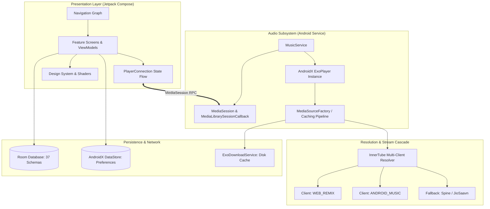
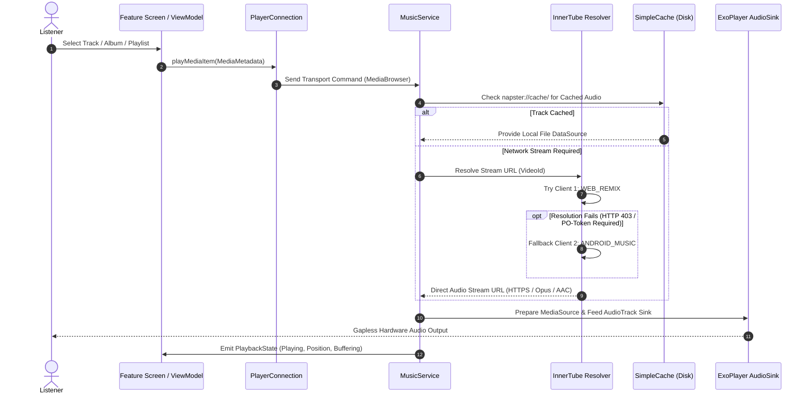

<div align="center">

# N A P S T E R

### Precision Audio Architecture for Android

<p align="center">
  An open-source, serverless Android music client engineered with Jetpack Compose, AndroidX Media3, and a multi-endpoint InnerTube streaming pipeline.
</p>

<p align="center">
  <a href="LICENSE"></a>
  <a href="version.properties"></a>
  <a href="docs/BUILD_AND_TEST.md"></a>
  <a href="docs/ARCHITECTURE.md"></a>
  <a href="docs/PRIVACY_AND_PERMISSIONS.md"></a>
</p>

<p align="center">
  <a href="#1-project-introduction"><b>OVERVIEW</b></a> &nbsp;&bull;&nbsp;
  <a href="#2-feature-catalogue"><b>FEATURES</b></a> &nbsp;&bull;&nbsp;
  <a href="#3-technology-stack"><b>TECH STACK</b></a> &nbsp;&bull;&nbsp;
  <a href="#4-system-architecture"><b>ARCHITECTURE</b></a> &nbsp;&bull;&nbsp;
  <a href="#5-playback-pipeline"><b>PLAYBACK PIPELINE</b></a> &nbsp;&bull;&nbsp;
  <a href="#6-search-and-playlist-import"><b>SEARCH & IMPORT</b></a> &nbsp;&bull;&nbsp;
  <a href="#7-persistence-and-storage"><b>PERSISTENCE</b></a> &nbsp;&bull;&nbsp;
  <a href="#8-integrations-matrix"><b>INTEGRATIONS</b></a> &nbsp;&bull;&nbsp;
  <a href="#9-privacy-and-permissions"><b>PRIVACY</b></a> &nbsp;&bull;&nbsp;
  <a href="#10-developer-quickstart"><b>QUICKSTART</b></a> &nbsp;&bull;&nbsp;
  <a href="#11-repository-structure"><b>STRUCTURE</b></a> &nbsp;&bull;&nbsp;
  <a href="#12-engineering-decisions"><b>DESIGN DECISIONS</b></a> &nbsp;&bull;&nbsp;
  <a href="#13-documentation-index"><b>DOCUMENTATION</b></a> &nbsp;&bull;&nbsp;
  <a href="#14-licensing-and-provenance"><b>PROVENANCE</b></a>
</p>

</div>

---

> [!IMPORTANT]
> **Independent Open-Source Notice:** Napster is an independent, community-driven open-source software project distributed under the GNU General Public Licence v3.0. It is **not** affiliated with, sponsored by, or endorsed by Google LLC, YouTube, Spotify AB, or any past or present commercial owner of the historic "Napster" trademark. This software operates entirely client-side without proprietary backend infrastructure or commercial subscriptions.

---

## 1. Project Introduction

### The Rationale
Modern mobile streaming clients increasingly prioritise algorithmic promotional feeds, tracking beacons, and walled gardens over user control, audio quality, and battery efficiency. **Napster** was engineered to return complete autonomy to the listener:
- **Serverless Operation:** Runs 100% on-device. No central server stores your listening history, account identifiers, or playback queries.
- **Resilient Media Pipeline:** Decouples playback logic from proprietary client locks by consuming open stream streams via a cascading, multi-client InnerTube resolver.
- **Tactile Material 3 Interface:** Employs Jetpack Compose with custom liquid-glass backdrop shaders, adaptive palette matching, and dedicated landscape/tablet adaptations.
- **Universal Bridge:** Enables users to import public Spotify playlists directly into their local on-device database without requiring a Spotify login or API token.

### Application Identity vs Architecture Namespace
The client is published with the application identifier `com.napster.music`. Within the source tree, the root Kotlin namespace is intentionally maintained as `com.beatwave.music`. This design decision preserves binary compatibility across 37 sequential Room database migrations (`1.json` through `37.json`), AndroidX DataStore preferences, and serialized disk caches without risking data loss for existing installations.

---

## 2. Feature Catalogue

### Core Audio & Playback
- **AndroidX Media3 / ExoPlayer Engine:** Built upon ExoPlayer 1.5.1 with customized audio sinks, continuous buffer management, and automatic audio focus handling.
- **Audio Equalisation & DSP Effects:** Integrated 5-band / 10-band graphic equaliser, bass boost, virtualiser, and system DSP intent forwarding.
- **DJ Mode & Beat-Matched Transitions:** Gapless playback, configurable crossfade durations, and automated beat-matching energy transitions.
- **Off-Screen & Background Playback:** Fully decoupled Android Foreground Service (`MusicService`) managing hardware media buttons, lock-screen notifications, and Bluetooth transport controls.
- **Local Audio Library:** Real-time scanning and merging of on-device audio files stored in device storage alongside cloud streams.
- **Offline Download Manager:** Background downloading managed by `ExoDownloadService` with parallel queue concurrency, network constraint enforcement (Wi-Fi only toggles), and disk cache deduplication.

### Interface & Experience
- **Liquid Glass & Dynamic Blur:** Source-integrated hardware-accelerated backdrop blur (`Kyant0/backdrop`) creating frosted glass aesthetics behind playback bars and navigation headers.
- **Synchronised Lyrics:** Multi-source lyrics engine querying LRCLIB, KuGou, Paxsenix, Better Lyrics, and local embedded LRC/TTML tags with word-level and line-level karaoke synchronisation.
- **Visual Canvas:** High-definition animated album canvas rendering supporting Apple Music canvas streams, Tidal canvas streams, and artist video loops.
- **Multiple Form Factors:** Dedicated responsive layouts for smartphones, tablets, foldables, and Android Auto dashboard displays.
- **Home Screen Widgets:** Compact, Now-Playing, Synchronised Lyrics, and Turntable interactive desktop widgets.

### Discovery & Integrations
- **Multi-Endpoint InnerTube Search:** Search songs, albums, artists, community playlists, and mood stations with instant client-side debouncing (300 ms).
- **Public Spotify Import:** Resolve and import any public Spotify playlist URL into native Room playlists using client-side scrapers without Spotify account credentials.
- **Audioscrobbling:** Native asynchronous scrobbling support for **Last.fm** and **ListenBrainz** via official REST endpoints.
- **Backup & Portability:** One-click encrypted JSON/SQLite database export and restoration for library entries, custom playlists, and playback settings.

### Intentionally Absent Features
To maintain uncompromising privacy and codebase stability, several non-essential legacy modules have been permanently purged:
- No real-time collaborative rooms or proprietary multi-user sync protocols.
- No private Spotify user authentication, cookies, or GraphQL account token extractors.
- No microphone-based ambient audio recognition (Shazam clones).
- No Discord Rich Presence sockets or external RPC daemons.
- No analytics SDKs, advertising frameworks, or crash telemetry endpoints.

---

## 3. Technology Stack

Napster uses modern, production-grade Android open-source technologies:

| Layer | Technology | Version | Architectural Responsibility |
|---|---|---|---|
| **Language** | Kotlin | `2.1.0` | Primary codebase language with Coroutines and Flow |
| **UI Framework** | Jetpack Compose | BOM `2024.12.01` | Declarative UI, Material 3, animations, and adaptive layouts |
| **Audio Engine** | AndroidX Media3 / ExoPlayer | `1.5.1` | Audio decoding, buffering, caching, and MediaSession |
| **Local Database** | AndroidX Room | `2.6.1` | SQLite persistence across 37 schema migrations |
| **Preferences** | AndroidX DataStore | `1.1.1` | Asynchronous key-value settings storage |
| **Dependency Injection** | Dagger Hilt | `2.54` | Application-wide compile-time dependency inversion |
| **Image Loading** | Coil 3 | `3.0.4` | Asynchronous image decoding, memory caching, and disk cache |
| **Networking & HTTP** | Ktor Client / OkHttp | `3.0.3` / `5.0.0-alpha.14` | HTTP/2, TLS connection pooling, and payload parsing |
| **Serialization** | Kotlinx Serialization | `1.7.3` | Multiplatform JSON serialization for models and APIs |
| **Backdrop Blur** | Kyant0/backdrop | Source | Hardware-accelerated frosted glass surface rendering |
| **Cast Extension** | Google Cast SDK | `22.0.0` | Optional Chromecast protocol routing (`gms` variant only) |

---

## 4. System Architecture

The repository enforces a clean, modular architecture separating presentation, domain, and data layers:



### Module Responsibilities
- **`:app`**: Application root containing Compose screens, Navigation graph, ViewModels, Hilt modules, Room DAOs, and the foreground `MusicService`.
- **`:innertube`**: Dedicated YouTube Music / InnerTube client engine handling request signing, protobuf payloads, and JSON stream models.
- **`:canvas` / `:applecanvas` / `:vivimusiccanvas` / `:artistvideo`**: Specialised visual stream renderers providing animated video album canvas art.
- **`:betterlyrics` / `:kugou` / `:lrclib` / `:paxsenixlyrics` / `:simpmusic`**: Modular lyric extractors queried concurrently via Kotlin Coroutines.
- **`:lastfm`**: Authenticated Last.fm REST API client with scrobble queueing and MD5 authentication hashing.
- **`:spotify`**: Public Spotify playlist scraper resolving web metadata into standard Song track queries.
- **`:jiosaavn` / `:spine`**: Secondary and regional media resolvers utilised when primary YouTube audio tracks are geo-restricted.

---

## 5. Playback Pipeline

Every audio playback event follows a deterministic, resilient lifecycle from user interaction to the hardware audio sink:



### Error Recovery & Resilient Caching
- **Bounded Retry Cascade:** If stream resolution yields an HTTP 403 or signature expiration, the resolver immediately fails over across distinct client signatures (`WEB_REMIX` &rarr; `ANDROID_MUSIC` &rarr; `WEB`).
- **Disk Caching:** Audio streams are segmented and cached in an isolated cache directory using ExoPlayer `SimpleCache` with an LRU eviction policy. Cache keys follow the strict internal format `napster://cache/{videoId}`.

---

## 6. Search and Playlist Import

### Debounced Multi-Type Search
The search architecture integrates a 300 ms debounce operator across Kotlin Flows. As characters are entered, queries are directed through InnerTube's suggest engine, yielding instantaneous suggestions alongside faceted category filters:
`All` &bull; `Songs` &bull; `Albums` &bull; `Artists` &bull; `Playlists` &bull; `Featured Stations`

### Public Spotify Playlist Importer
Users can paste any public Spotify playlist URL (e.g. `https://open.spotify.com/playlist/...`). Napster processes the request client-side without authenticating with Spotify:

```
[Spotify Public URL] 
        │
        ▼ (Client-side HTML/Metadata Scraper)
[Extract: Track Title, Primary Artist, Duration, Album]
        │
        ▼ (Coroutines Async Resolution Batch)
[Query InnerTube Engine per Track with Fuzzy Matching]
        │
        ▼ (Relational Insertion)
[Insert Resolved Songs into Local Room Playlist]
```

---

## 7. Persistence and Storage

### Room Relational Database
Napster maintains an SQLite database managed via AndroidX Room with 37 sequential migration stages. Strict schema integrity guarantees that existing user data is preserved across application updates.

| Table Entity | Primary Role |
|---|---|
| `Song` | Track metadata, duration, local file paths, and thumbnail references |
| `Artist` | Artist biographies, subscriber counts, and thumbnail artwork |
| `Album` | Release year, artist relations, track counts, and cover images |
| `Playlist` & `PlaylistSongMap` | Custom user playlists and relational song mappings |
| `SearchHistory` | Local user search terms with chronological indexing |
| `PlaybackState` | Persistent queue position, volume, and playback state |
| `Format` | Audio stream encoding, bitrate, and mime types for offline playback |
| `Lyrics` | Cached LRC and plain-text lyrics indexed by track identifier |

### DataStore Preferences
Non-relational preferences (equaliser band gains, theme selection, dynamic colours, download quality, and crossfade duration) are stored asynchronously using AndroidX DataStore.

---

## 8. Integrations Matrix

| Service | Mechanism | Authentication Required | Purpose | Failure Behaviour |
|---|---|---|---|---|
| **YouTube Music** | InnerTube Client | No (Client-side requests) | Primary audio streaming, search, feeds | Cascades to alternative client headers |
| **Spotify** | Public Web Scraper | **No** (Public lists only) | Playlist tracklist extraction | Displays parsing error alert to user |
| **Last.fm** | REST API | Yes (API Key + User Session) | Asynchronous audioscrobbling | Caches scrobble offline, retries later |
| **ListenBrainz** | REST API | Yes (User API Token) | Open scrobbling protocol | Drops non-critical telemetry packet |
| **LRCLIB** | REST API | No | Synchronised LRC lyric provider | Falls back to KuGou or Paxsenix |
| **Apple Music** | CDN Endpoint | No | High-resolution animated canvas video | Falls back to static album artwork |

---

## 9. Privacy and Permissions

Napster adheres to a strict zero-telemetry policy. The application requires only the minimal set of Android runtime permissions necessary to deliver local and streaming audio playback:

```xml
<!-- Network Communications -->
<uses-permission android:name="android.permission.INTERNET" />
<uses-permission android:name="android.permission.ACCESS_NETWORK_STATE" />

<!-- Background Playback -->
<uses-permission android:name="android.permission.FOREGROUND_SERVICE" />
<uses-permission android:name="android.permission.FOREGROUND_SERVICE_MEDIA_PLAYBACK" />
<uses-permission android:name="android.permission.WAKE_LOCK" />

<!-- Local Storage Audio Library -->
<uses-permission android:name="android.permission.READ_EXTERNAL_STORAGE" android:maxSdkVersion="32" />
<uses-permission android:name="android.permission.READ_MEDIA_AUDIO" />

<!-- System Integration -->
<uses-permission android:name="android.permission.POST_NOTIFICATIONS" />
```

- **Zero Analytics:** Contains no Firebase Analytics, Mixpanel, Segment, or proprietary metrics SDKs.
- **Zero Crash Telemetry:** No Sentry, Crashlytics, or Bugsnag libraries. Crash logs remain purely on-device in `adb logcat`.
- **No Account Required:** Operates immediately after installation without mandatory registration, email, or telephone verification.

---

## 10. Developer Quickstart

### Prerequisites
- **Java Development Kit (JDK):** Version 17 or Version 21 (JDK 21 recommended).
- **Android SDK:** Installed with Build-Tools `35.0.0` and Platform API `36`.
- **Android NDK:** Version `27.0.12077973` (configured via `local.properties` or `ANDROID_NDK_HOME`).
- **Gradle:** Wrapper included (Gradle 8.11.1).

### Build Variants
- **`arm64Foss`**: Primary development flavour. Excludes proprietary Google Mobile Services (GMS) binaries and includes full 64-bit ARM optimizations.
- **`universalFoss`**: 100% Free and Open Source variant bundled for all CPU architectures (`arm64-v8a`, `armeabi-v7a`, `x86_64`).
- **`universalGms`**: Universal build containing Google Cast SDK bindings for Chromecast streaming.

### Compilation Commands

```powershell
# 1. Clone the repository
git clone https://github.com/slythnox/Napster.git
cd Napster

# 2. Build the primary ARM64 FOSS Debug APK
.\gradlew.bat --no-daemon :app:assembleArm64FossDebug

# 3. Execute all unit tests across the application and submodules
.\gradlew.bat --no-daemon :app:testArm64FossDebugUnitTest

# 4. Install directly onto a connected physical device or emulator
.\gradlew.bat --no-daemon :app:installArm64FossDebug
```

---

## 11. Repository Structure

```
BeatWave-main/
├── app/                         # Primary Android application module
│   ├── src/main/kotlin/com/beatwave/music/
│   │   ├── app/                 # Application class & Activity lifecycle
│   │   ├── db/                  # Room Database, migrations (1-37), DAOs, entities
│   │   ├── feature/             # UI features (home, player, search, library, settings)
│   │   ├── playback/            # MusicService, PlayerConnection, MediaSession
│   │   └── ui/                  # Compose theme, components, Liquid Glass shaders
│   └── src/main/res/            # Android resources, vector drawables, layouts
├── innertube/                   # Independent YouTube Music / InnerTube client engine
├── canvas/                      # Abstract animated canvas decoding infrastructure
├── applecanvas/                 # Apple Music canvas video resolution module
├── vivimusiccanvas/             # Community canvas service bridge
├── artistvideo/                 # Artist video canvas playback integration
├── lrclib/                      # LRCLIB lyrics API consumer
├── betterlyrics/                # BetterLyrics provider module
├── kugou/                       # KuGou multi-language lyrics parser
├── paxsenixlyrics/              # Paxsenix lyrics engine client
├── simpmusic/                   # Auxiliary lyrics and music metadata parser
├── spotify/                     # Public Spotify playlist importer (no authentication)
├── lastfm/                      # Last.fm and ListenBrainz REST scrobbling client
├── jiosaavn/                    # Secondary regional audio resolution provider
├── spine/                       # Fallback audio streaming client
├── docs/                        # Complete technical documentation index (16 guides)
│   └── assets/readme/           # Vector illustrations and README artwork
└── gradle/                      # Gradle wrapper configuration and dependency catalogs
```

---

## 12. Engineering Decisions

### Architectural Trade-Offs
1. **Retaining Package Namespace `com.beatwave.music`:**
   While the public application ID and product identity are `com.napster.music`, modifying the root Kotlin package would invalidate serialised AndroidX Room migrations and reset all existing user SQLite databases upon upgrade. Retaining the namespace ensures backwards compatibility.
2. **Multi-Module Lyrics Separation:**
   Each lyrics provider (`lrclib`, `kugou`, `paxsenixlyrics`, `betterlyrics`) is isolated in its own Gradle subproject. This guarantees that API breaking changes in a single third-party provider never compromise the core playback service or UI compilation.
3. **Decoupled Playback via `PlayerConnection`:**
   UI components never hold direct references to `ExoPlayer` or `MusicService`. Communication is handled through an IPC bridge powered by AndroidX Media3's `MediaBrowser` and Kotlin StateFlows, preventing memory leaks during Activity recreation and orientation changes.

---

## 13. Documentation Index

For exhaustive technical references, inspect the comprehensive engineering documentation in the [`docs/`](docs/) directory:

| Document | Description |
|---|---|
| [`docs/ARCHITECTURE.md`](docs/ARCHITECTURE.md) | Detailed architectural patterns, Clean Architecture, and module graph |
| [`docs/SETUP.md`](docs/SETUP.md) | Complete workstation environment, IDE, and SDK configuration instructions |
| [`docs/BUILD_AND_TEST.md`](docs/BUILD_AND_TEST.md) | Gradle compilation, test suites, ProGuard/R8 rules, and release signing |
| [`docs/FEATURES.md`](docs/FEATURES.md) | Comprehensive inventory of active features, UI components, and limitations |
| [`docs/PLAYBACK.md`](docs/PLAYBACK.md) | Audio pipeline lifecycle, MediaSession callbacks, and caching logic |
| [`docs/SEARCH_AND_SPOTIFY_IMPORT.md`](docs/SEARCH_AND_SPOTIFY_IMPORT.md) | Debouncing, InnerTube search filters, and public Spotify scraping logic |
| [`docs/DATABASE_AND_PREFERENCES.md`](docs/DATABASE_AND_PREFERENCES.md) | Room SQLite schema definitions, 37 migrations, and DataStore structures |
| [`docs/INTEGRATIONS.md`](docs/INTEGRATIONS.md) | Third-party service configuration, API keys, and graceful degradation |
| [`docs/PRIVACY_AND_PERMISSIONS.md`](docs/PRIVACY_AND_PERMISSIONS.md) | Comprehensive audit of device permissions, network calls, and data flows |
| [`docs/BRANDING_AND_ATTRIBUTION.md`](docs/BRANDING_AND_ATTRIBUTION.md) | Detailed lineage, trademark notices, and upstream open-source attribution |
| [`docs/CONTRIBUTING.md`](docs/CONTRIBUTING.md) | Code styling guidelines, pull request protocols, and review standards |
| [`docs/TROUBLESHOOTING.md`](docs/TROUBLESHOOTING.md) | Common compilation issues, audio focus bugs, and runtime diagnostics |
| [`docs/RELEASE_CHECKLIST.md`](docs/RELEASE_CHECKLIST.md) | Quality assurance, automated test verification, and APK signing steps |
| [`docs/CLEANUP_HISTORY.md`](docs/CLEANUP_HISTORY.md) | Historical record of deprecated module removals and architectural refactoring |

---

## 14. Licensing and Provenance

### Software Licence
Napster is licensed under the **GNU General Public Licence v3.0 (GPL-3.0)**. Permissions of this strong copyleft licence are conditioned on making available complete source code of licensed works and modifications under the same licence. See the [`LICENSE`](LICENSE) file for the full legal text.

### Upstream Open-Source Lineage
This application represents the evolution of notable open-source music players within the Android ecosystem:
- **BeatWave:** Upstream foundation, design direction, and feature integrations.
- **vivi-music** *(by Vividh P Ashokan)*: Foundational Android architecture and Apple Music-inspired presentation style.
- **CONVX:** Media player layout optimizations and user experience contributions.
- **InnerTune** *(by Malopieds)*: Original InnerTube API reverse-engineering implementation and Room schema foundation.

### AI-Assisted Development Disclosure
Portions of the codebase refactoring, architectural auditing, test suite authoring, and documentation generation were performed with the assistance of advanced artificial intelligence models (Google Gemini and Anthropic Claude). All machine-assisted outputs were rigorously inspected, validated, compiled, and verified by human maintainers. In adherence to open-source software governance, AI systems are not granted authorship status; all copyright and legal responsibilities remain with the human contributors and respective upstream licence holders.

---

<div align="center">
  <sub>Engineered for uncompromising listening freedom. Free software for everyone.</sub>
</div>
