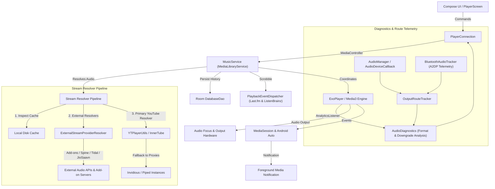

# Playback Engine and Media Architecture

This document describes the media playback architecture, service lifecycle, queue coordination, caching mechanisms, and stream resolution pipeline in Napster.

---

## 1. Architecture Overview



---

## 2. Core Components

### `MusicService` (`playback/MusicService.kt`)
`MusicService` extends `MediaLibraryService` and operates as an Android foreground service. Its responsibilities comprise:
- **ExoPlayer Lifecycle:** Initialisation, audio offload, audio attributes, playback speed, pitch adjustments, and thorough resource disposal in `onDestroy()`.
- **MediaSession and Android Auto:** Broadcasts playback state, metadata, and playlist trees to the system notification shade, lock-screen controls, and Android Auto dashboards.
- **Audio Focus Management:** Automatically ducks or pauses audio when phone calls arrive, navigation prompts speak, or other audio applications request transient focus.
- **Queue Coordination:** Manages the sequential play queue, shuffle order, repeat modes (`None`, `All`, `One`), and automated queue continuation based on similar tracks.
- **Non-Blocking Preference Observation:** All preference parameters (e.g. repeat mode, crossfade durations, persistent queue enablement) are cached in-memory (`cachedRepeatMode`, `cachedPersistentQueue`, `cachedAutoLoadMore`) and maintained asynchronously via a single `distinctUntilChanged` DataStore flow collector. Main-thread execution in `Player.Listener` callbacks is strictly non-blocking.
- **Asynchronous Cache Eviction:** Stream cache deletion on quality reload executes off the main thread via coroutines on `Dispatchers.IO`, preventing UI frame drops.

### `PlayerConnection` (`playback/PlayerConnection.kt`)
`PlayerConnection` provides a reactive bridge between Jetpack Compose UI state and the background `MusicService`:
- Uses AndroidX Media3 `MediaBrowser` and `MediaController` interfaces.
- Exposes Kotlin `StateFlow` streams conveying playback position, buffered duration, active track metadata, playback error conditions, and shuffle/repeat states.
- Executes bounded asynchronous commands without blocking the Compose composition pipeline.

---

## 3. Stream Resolution Pipeline

When a track is prepared for playback:

1. **Local Disk Cache Inspection:** The player checks whether complete or partial media chunks exist in the offline ExoPlayer simple cache directory.
2. **External Provider Resolution (`ExternalStreamProviderResolver.kt`):**
   - **HTTP Streaming Add-ons:** If configured, modular add-on sources are queried first via `AddonSource`. Manifest caching, in-flight deduplication (`SharedCalls`), and rate-limit backoff protect external endpoints. If the candidate track supplies a direct `streamURL`, it is dispatched immediately. `TrackMatcher` validates duration and title, rejecting remixes or live versions to prevent silent track mismatches.
   - **External Hi-Fi Sources:** If enabled by explicit user opt-in (`EnableSpineKey`, `EnableTidalStreamingKey`, `EnableJioSaavnKey`), secondary stream providers (Spine, Tidal, JioSaavn) are evaluated in sequence.
   - **Scoped Metadata Fetching:** YouTube metadata queries (`YouTube.next(videoId)`) are performed via a scoped lazy provider (`getYtMetadata()`). The first external provider triggers the lookup; subsequent fallback providers reuse the cached title, artist, and duration instantly in 0 ms.
3. **Primary YouTube Resolution (`YTPlayerUtils.kt`):**
   - Direct streaming URLs are resolved from YouTube Music via InnerTube endpoints, selecting optimal audio streams (WebM/Opus or M4A/AAC).
   - **Terminal Error Abort:** The resolver inspects response payloads using `BotDetectionMitigator.isUniversalTerminalError()`. Unrecoverable terminal states (e.g. deleted videos, copyright strikes, private clips) terminate fallback iteration immediately, avoiding 15–30-second multi-client retry delays. Recoverable network or throttling errors retain standard multi-client rotation.

---

---

## 4. Audio Diagnostics and Hardware Route Telemetry

Napster incorporates a truth-first telemetry pipeline providing complete transparency into the audio rendering pipeline:

```
Media3 Decoder Format (AnalyticsListener)
  └─► AudioDiagnostics (Codecs, Sample Rate, Bit Depth, Bitrate)
        ├─► Downgrade Detection (Lossless claim vs lossy/downsampled input)
        └─► OutputRouteTracker (AudioDeviceCallback + BluetoothAudioTracker)
              └─► UI Layer (AudioQualityBadge & ShowMediaInfo dialog)
```

- **Decoder Telemetry:** Captured on `AnalyticsListener.onAudioInputFormatChanged()`. Reports actual media codec (`audio/flac`, `audio/opus`, `audio/mp4a-latm`), channels, sample rate, bit depth, and bitrate.
- **Downgrade Analysis:** When a source advertises lossless audio but the decoder is fed lossy Opus/AAC or downsampled audio, `AudioDiagnostics` flags the stream as `DOWNGRADED` with visual indicators in the player UI.
- **Hardware Sink Classification:** Identifies active physical audio sinks:
  - `Internal Speaker` (default phone transducers)
  - `Wired Line/Headset` (3.5 mm / USB-C analog adapters)
  - `USB Audio Out` (direct USB DAC / external sound card)
  - `HDMI / Digital Multi-Channel`
- **Bluetooth A2DP Codec Telemetry:** Interrogates Android Bluetooth profile proxy (`BluetoothA2dp`) to capture negotiated Bluetooth codecs (LDAC, aptX HD, aptX Adaptive, AAC, SBC, Samsung Seamless Codec) along with operating sample rates.
- **Non-Interfering Architecture:** Telemetry runs entirely on background listeners and UI observation flows. It **never** blocks, halts, or alters audio execution.
- **Technical Limitations:** Telemetry reflects the parameters reported by the Android framework. Audio is output through Android's standard AudioTrack/AudioFlinger pipeline, where system resampling to 48 kHz may occur depending on device hardware and OEM audio policies. No unsupported "bit-perfect" or hardware bypass promises are made.

---

## 5. Per-Network Quality Resolution & Network Handover

`MusicService` reactively evaluates audio quality by observing DataStore preferences and network state:

1. **Preference Hierarchy:**
   - If `DataSaverEnabledKey` is active $
ightarrow$ forces `AudioQuality.LOW`.
   - Checks active network transport:
     - `TRANSPORT_CELLULAR` $
ightarrow$ resolves `MobileAudioQualityKey`.
     - `TRANSPORT_WIFI` or `TRANSPORT_ETHERNET` $
ightarrow$ resolves `WifiAudioQualityKey`.
     - Ambiguous / unmetered hotspot $
ightarrow$ falls back to `connectivityManager.isActiveNetworkMetered`.
   - If per-network preference is unset (`null`), falls back to global `AudioQualityKey`.
   - If global setting is unconfigured, defaults to `AudioQuality.AUTO`.
2. **Seamless Network Transition:**
   - `NetworkConnectivityObserver` listens to `onCapabilitiesChanged` in addition to available/lost events.
   - When transitioning from Wi-Fi to cellular (or vice-versa), `MusicService` recalculates the target quality.
   - If the resolved quality level actually differs and media is actively playing, the stream is re-fetched and resumed seamlessly at the same playback position; otherwise, playback continues without reload.

## 6. Audio Effects and Processing

- **DJ Mode and Transitions:** Automated beat tracking (`BeatTracker.kt`), musical key analysis (`KeyDetector.kt`), and energy profiling (`EnergyProfile.kt`) calculate seamless crossfade transition points between successive tracks.
- **Audio Normalisation:** ReplayGain and LoudnessEnhancer parameters normalise volume discrepancies across diverse source streams.
- **Smart Crossfade:** Soft volume interpolation between outgoing and incoming audio streams.
- **Multi-Band Equaliser:** User-adjustable frequency bands with preset configurations (Bass Boost, Vocal, Electronic, Acoustic) and custom profile persistence.

---

## 7. Download Management & Lossless Export

Offline caching and deliberate track downloads are orchestrated by `DownloadService` and ExoPlayer `DownloadManager`. Downloaded assets reside within application-private storage, indexed by Room database entries, and seamlessly substituted for remote streams whenever the device is offline.

### Lossless FLAC File Export (`SongExporter.kt` & `FlacTagger.kt`)
- Users can export downloaded or cached tracks directly to external storage via Android's Storage Access Framework.
- If the track was cached as genuine lossless FLAC (`$songId#flac`), `SongExporter` verifies the `fLaC` stream magic and invokes `FlacTagger` to embed standard Vorbis comment tags (TITLE, ARTIST, ALBUM), front cover art, and synchronized lyrics directly into the exported `.flac` file.
- Raw audio frame streams are copied byte-for-byte untouched, guaranteeing zero quality degradation or re-encoding artifacts.
- Non-FLAC sources (e.g. YouTube Opus/AAC streams) are cleanly remuxed/transcoded to `.m4a` format without mislabeling them as FLAC.
