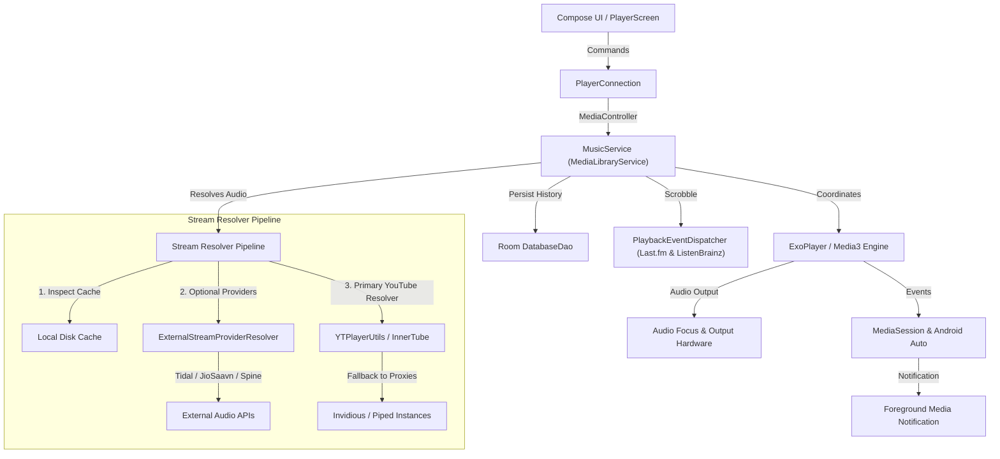

# Playback Engine and Media Architecture

This document describes the media playback architecture, service lifecycle, queue coordination, caching mechanisms, and stream resolution pipeline in Napster.

---

## 1. Architecture Overview

---

## 2. Core Components

### `MusicService` (`playback/MusicService.kt`)
`MusicService` extends `MediaLibraryService` and operates as an Android foreground service. Its responsibilities comprise:
- **ExoPlayer Lifecycle:** Initialisation, audio offload, audio attributes, playback speed, pitch adjustments, and thorough resource disposal in `onDestroy()`.
- **MediaSession and Android Auto:** Broadcasts playback state, metadata, and playlist trees to the system notification shade, lock-screen controls, and Android Auto dashboards.
- **Audio Focus Management:** Automatically ducks or pauses audio when phone calls arrive, navigation prompts speak, or other audio applications request transient focus.
- **Queue Coordination:** Manages the sequential play queue, shuffle order, repeat modes (`None`, `All`, `One`), and automated queue continuation based on similar tracks.
- **Non-Blocking Preference Observation:** All preference parameters (e.g. repeat mode, crossfade durations, persistent queue enablement) are cached in-memory (`cachedRepeatMode`, `cachedPersistentQueue`, `cachedAutoLoadMore`) and maintained asynchronously via a single `distinctUntilChanged` DataStore flow collector. Main-thread execution in `Player.Listener` callbacks is strictly non-blocking.
- **Asynchronous Cache Eviction:** Stream cache deletion on quality reload executes off the main thread via coroutines on `Dispatchers.IO`, preventing UI frame drops.

### `PlayerConnection` (`playback/PlayerConnection.kt`)
`PlayerConnection` provides a reactive bridge between Jetpack Compose UI state and the background `MusicService`:
- Uses AndroidX Media3 `MediaBrowser` and `MediaController` interfaces.
- Exposes Kotlin `StateFlow` streams conveying playback position, buffered duration, active track metadata, playback error conditions, and shuffle/repeat states.
- Executes bounded asynchronous commands without blocking the Compose composition pipeline.

---

## 3. Stream Resolution Pipeline

When a track is prepared for playback:

1. **Local Disk Cache Inspection:** The player checks whether complete or partial media chunks exist in the offline ExoPlayer simple cache directory.
2. **External Provider Resolution (`ExternalStreamProviderResolver.kt`):**
   - If enabled by the user, high-quality audio alternatives (Tidal, JioSaavn, Spine) are queried sequentially.
   - **Scoped Metadata Fetching:** YouTube metadata queries (`YouTube.next(videoId)`) are performed via a scoped lazy provider (`getYtMetadata()`). The first external provider triggers the lookup; subsequent fallback providers reuse the cached title, artist, and duration instantly in 0 ms.
3. **Primary YouTube Resolution (`YTPlayerUtils.kt`):**
   - Direct streaming URLs are resolved from YouTube Music via InnerTube endpoints, selecting optimal audio streams (WebM/Opus or M4A/AAC).
   - **Terminal Error Abort:** The resolver inspects response payloads using `BotDetectionMitigator.isUniversalTerminalError()`. Unrecoverable terminal states (e.g. deleted videos, copyright strikes, private clips) terminate fallback iteration immediately, avoiding 15–30-second multi-client retry delays. Recoverable network or throttling errors retain standard multi-client rotation.

---

## 4. Audio Effects and Processing

- **DJ Mode and Transitions:** Automated beat tracking (`BeatTracker.kt`), musical key analysis (`KeyDetector.kt`), and energy profiling (`EnergyProfile.kt`) calculate seamless crossfade transition points between successive tracks.
- **Audio Normalisation:** ReplayGain and LoudnessEnhancer parameters normalise volume discrepancies across diverse source streams.
- **Smart Crossfade:** Soft volume interpolation between outgoing and incoming audio streams.
- **Multi-Band Equaliser:** User-adjustable frequency bands with preset configurations (Bass Boost, Vocal, Electronic, Acoustic) and custom profile persistence.

---

## 5. Download Management

Offline caching and deliberate track downloads are orchestrated by `DownloadService` and ExoPlayer `DownloadManager`. Downloaded assets are encrypted and stored within application-private storage, indexed by Room database entries, and seamlessly substituted for remote streams whenever the device is offline.
