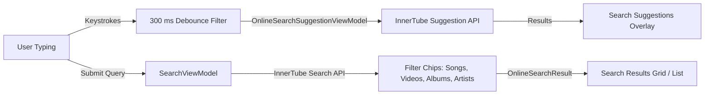
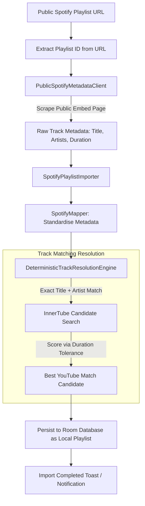
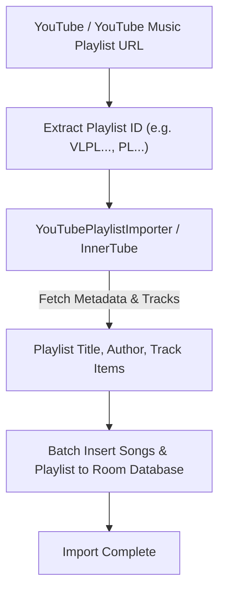

# Search and Playlist Import Pipeline (Spotify & YouTube Music)

This document describes the search architecture, query debouncing mechanisms, and the public playlist import pipelines for Spotify and YouTube Music.

---

## 1. Search Pipeline

### Search Engineering Characteristics
- **300 ms Keystroke Debouncing:** In `OnlineSearchSuggestionViewModel.kt`, query flows apply `.debounce { if (it.isEmpty()) 0L else 300L }`. Empty strings trigger an immediate 0 ms reset, whilst non-empty queries debounce by 300 ms, completely eliminating network flood during rapid typing.
- **Non-Blocking Preference Access:** Search localization parameters (country code, content language) are read asynchronously via `context.dataStore.data.first()` off the main looper.
- **Categorical Deduplication:** Heterogeneous results across YouTube Music categories are filtered to prevent redundant track entries within result rows.
- **Android Auto Integration:** MediaLibrarySession search queries execute direct SQL `LIKE` queries against Room rather than dumping entire song tables into memory.

---

## 2. Public Spotify Playlist Import Pipeline

Napster incorporates a privacy-preserving playlist importer that ingests Spotify playlists without requiring user authentication, OAuth tokens, or account credentials.

### Pipeline Details
1. **URL Validation and ID Extraction:** The user provides an `open.spotify.com/playlist/{id}` or `spotify:playlist:{id}` link. The importer extracts the 22-character alphanumeric playlist identifier.
2. **Public Metadata Scraping (`PublicSpotifyMetadataClient.kt`):**
   - Fetches the public embed document hosted at `open.spotify.com/embed/playlist/{id}`.
   - Extracts structured JSON embedded within script tags containing track names, artist names, album titles, track durations in milliseconds, and cover art URLs.
   - Requires zero user cookies or authenticated API sessions.
3. **Deterministic Track Matching (`DeterministicTrackResolutionEngine.kt`):**
   - For each scraped track, performs an InnerTube search using `{track_name} {artist_name}`.
   - Evaluates search candidates against duration bounds (typically within ±5 seconds of the source track length).
   - Selects the optimal matching YouTube Music video ID.
4. **Local Database Persistence:**
   - Persists the resolved song entities and creates a new local `PlaylistEntity` within Room.
   - Maps track associations via `PlaylistSongMap` records in a single database transaction.
   - The imported playlist becomes fully playable offline and locally editable like any native playlist.

---

## 3. Public YouTube Music Playlist Import Pipeline

Napster also supports importing public and unlisted YouTube and YouTube Music playlists directly without requiring account sign-in or OAuth tokens.

### Pipeline Characteristics
1. **URL Validation & ID Normalisation:** Accepts various URL formats (`music.youtube.com/playlist?list=...`, `youtube.com/playlist?list=...`, `youtu.be/...`, or raw playlist IDs), stripping prefixes like `VL` when needed.
2. **Unauthenticated InnerTube Extraction:** Directly queries YouTube Music's public browse endpoint with the playlist browse ID. All tracks, thumbnails, artist information, and durations are retrieved in batch.
3. **Reactive UI & Error Handling:** `YouTubeImportViewModel` emits reactive import states (`Idle`, `Loading`, `Success`, `Error`) with real-time imported track count updates and a retry dialog upon network failures.
4. **Relational Persistence:** Automatically creates the playlist record, saves all contained songs, and creates `PlaylistSongMap` bindings in a Room transaction.
